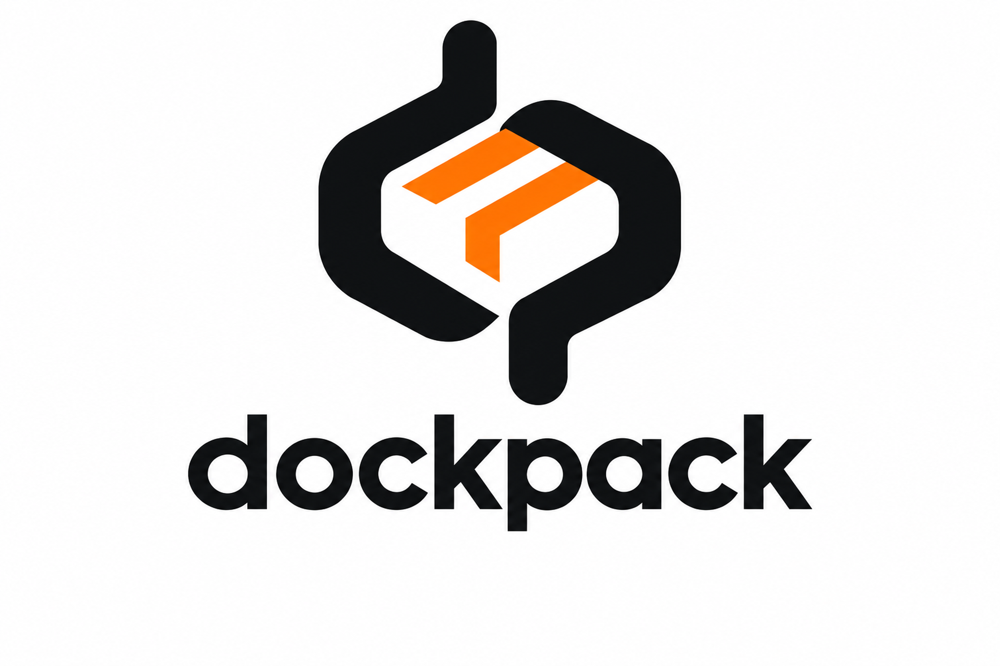

<p align="center">
  
</p>

<h1 align="center">dockpack</h1>

<p align="center">把开发环境打包带走，让离线开发顺利开始。</p>

dockpack 是一个面向离线环境的项目打包工具：在**联网电脑上准备运行时、项目依赖和 Docker 镜像**，将它们打包带到**离线机器上开发、构建和部署**。

## 支持范围

- **Node.js**：npm（`package-lock.json`）。
- **Python**：uv（`uv.lock`）或 pip（`requirements.txt` / `requirements-dev.txt`）。
- 支持将 Docker Compose 配套服务一起打包。

## 快速开始

两端均需提前安装并启动 **Docker 和 Docker Compose v2**；联网电脑还需 **Node.js 20+**。离线机器无需预装 Node.js 或 Python。

### 1. 联网准备

```sh
npm install -g dockpack-cli
cd my-project
dockpack init
```

检查生成的 `.dockpack.yaml`，确认目标架构、启动命令和端口。以下以 Linux x64 离线机器为例，`target.dev_platform` 设为 `linux/amd64`。

```sh
dockpack pack dev
dockpack download -p linux/amd64
```

将**项目目录**（含源码、配置、锁文件和 `.dockpack/` 开发包）及下载的 **CLI 运行包**传入离线机器。开发包不包含源码或数据库数据。

### 2. 离线启动

解压 CLI 运行包并将其目录加入 `PATH`，具体步骤见[离线工具安装](./docs/offline-runtime.md)。然后进入项目目录：

```sh
cd my-project
dockpack dev init
dockpack dev start
```

源码修改由项目自身的开发服务处理热更新；新增或升级依赖后，需要回到联网电脑重新打包，再传入离线机器执行 `dockpack dev init`。

## 常用命令

```sh
dockpack dev stop       # 停止开发服务
dockpack dev rebuild    # 使用已有离线缓存重新安装依赖
dockpack --help         # 查看帮助
```

## 文档

- [完整上手指南与常见问题](./docs/getting-started.md)
- [配置指南](./docs/configuration.md)
- [离线工具安装](./docs/offline-runtime.md)
- [生产部署、备份与恢复](./docs/production.md)
- [命令参考](./docs/commands.md)
- [Roadmap](./ROADMAP.md)
